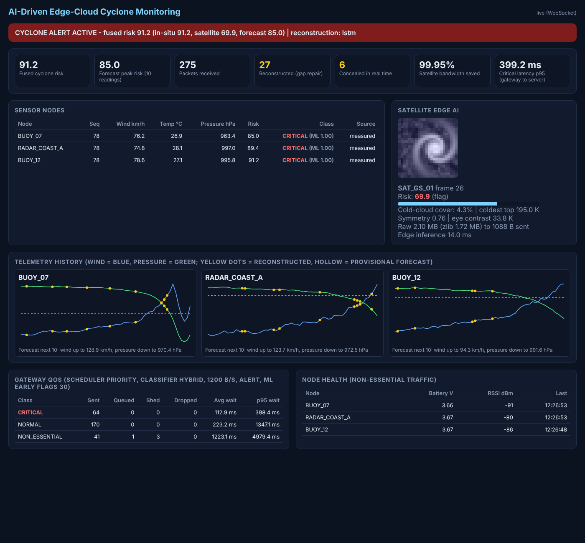

# AI-Driven Edge–Cloud Network for Cyclone Prediction and Resilient Ocean Telemetry

Software implementation of the project specification: ocean buoys, coastal radars and
satellite ground stations send lightweight telemetry over lossy links. An **edge
gateway** classifies the traffic and prioritises it on a constrained backbone. A
**central server** reconstructs lost packets with an LSTM, fuses everything into a
cyclone-risk prediction and streams it to a live dashboard.

```
 Buoys / radars ─UDP─┐                ┌─ validate → classify (rule + ML) → QoS scheduler ─UDP─┐
 (sensor_node.py or  ├─► EDGE GATEWAY ┤   CRITICAL > NORMAL > NON_ESSENTIAL, token-bucket     │
  ESP32 hardware)    │  edge_gateway  └─  backbone, critical reserve, alert-time shedding      │
 Satellite station ──┘        ▲                                                                ▼
 (edge AI: 2 MB frame         │ QoS feedback (alert on/off)                 CENTRAL SERVER (central_server.py)
  → 1 KB features)            └──────────────────────────────────── gap repair (LSTM), real-time concealment,
                                                                    risk fusion + forecast, REST + WebSocket
 ESP32 LED/buzzer ◄── alert (UDP 9004) ── gateway                               ▼
                                                                         Dashboard (browser)
```



## Quick start

```bash
pip install -r requirements.txt
python run_demo.py            # starts everything; open http://127.0.0.1:8000
```

Within about a minute the simulated cyclone reaches the buoys: traffic turns `CRITICAL`,
the gateway enters alert mode and reserves bandwidth, lost packets appear as yellow dots
(reconstructed), and the fused risk crosses the alert threshold.

Other entry points:

```bash
python run_demo.py --duration 90              # run headless and print final metrics
python run_demo.py --scheduler fifo --policy rule --recon linear   # the "no AI / no QoS" baseline
python train_models.py                        # retrain the LSTM + QoS classifier (~30 s, numpy only)
python evaluate.py                            # reproduce results/REPORT.md (~1-2 min)
python -m pytest -q                           # 28 tests
```

You can still start each component in its own terminal, as in Review 1:

```bash
uvicorn central_server:app --port 8000
python edge_gateway.py                        # --policy rule|ml|hybrid  --scheduler priority|fifo  --backbone-bps 1500
python sensor_node.py --node BUOY_07 --loss 0.15 --burst 0.6 --cyclone-after 15
python satellite_station.py --node SAT_GS_01 --cyclone-after 5
```

## What each file does (spec section in brackets)

| File | Role |
|---|---|
| `common.py` | Telemetry format, ports (overridable with env vars), traffic classes, packet validation, rule classifier [9.2, 9.4, FIG. 5] |
| `ocean_model.py` | Cyclone physics (Rankine wind + Holland pressure profile, gusts, diurnal temp, rain cooling) and a bursty Gilbert-Elliott loss channel |
| `sensor_node.py` | Buoy/radar simulator: realistic cyclone passage, bursty loss, housekeeping packets, ground-truth log [9.2, 9.5] |
| `satellite_station.py` | Synthetic 4-band 16-bit satellite frames; runs edge AI and forwards only features (~1 KB instead of 2 MB) [9.3, Example 4] |
| `edge_ai.py` | Dvorak-inspired image features (cold-cloud cover, symmetry, eye) → risk score; logistic-regression **ML QoS classifier** on pressure/wind trends [9.3, 9.4] |
| `qos.py` | QoS scheduler: token-bucket backbone, strict priority, critical bandwidth reserve, shedding under congestion; FIFO baseline [9.4, FIG. 7] |
| `edge_gateway.py` | Edge gateway: validate → classify (rule / ML / hybrid) → schedule → forward; alert logic, server feedback, hardware alert notifications [9.3, 9.4, FIG. 8] |
| `lstm.py` | Small LSTM in pure numpy (forward pass, backpropagation through time, Adam). No PyTorch needed, runs on a Raspberry Pi |
| `reconstruction.py` | Gap repair (LSTM forecast anchored to the next received packet, or linear) and real-time forecasting [9.5] |
| `central_server.py` | FastAPI server: gap repair, provisional real-time concealment, late-packet swap-in, reboot detection, risk fusion + 10-step forecast, QoS feedback, REST + WebSocket [9.5–9.7] |
| `dashboard.html` | Live dashboard (no external libraries, works offline) |
| `train_models.py` | Trains `models/lstm_recon.npz` and `models/qos_classifier.npz` on 280 randomised cyclone scenarios |
| `evaluate.py` | Validation experiments from spec sections 12/13 and Appendix C → `results/REPORT.md`, plots |
| `run_demo.py` | One-command launcher with logs in `logs/` |
| `mininet_topology.py` | Optional Mininet WAN emulation with netem bandwidth/delay/loss [9.8] |
| `hardware/` | **ESP32 sensor-node firmware, optional LoRa link, wiring and shopping list**: see [hardware/README.md](hardware/README.md) |
| `tests/` | Unit and integration tests |

## REST / WebSocket API

| Endpoint | Returns |
|---|---|
| `GET /` | Dashboard |
| `GET /predict` | Latest reading per node, fused risk (in-situ / satellite / forecast components), alert flag, 10-step forecast per node |
| `GET /status` | Packet counters (received, reconstructed, concealed, late-recovered, duplicates, invalid, critical) |
| `GET /telemetry/{node}?limit=20` | Recent history of a node (reconstructed and provisional records are flagged) |
| `GET /satellite` | Latest edge-AI feature record per ground station |
| `GET /gateway` | Gateway QoS statistics per traffic class |
| `GET /metrics` | Latency per class, bandwidth reduction, recovery counts |
| `GET /snapshot`, `WS /ws` | Everything the dashboard shows (WebSocket pushes it every second) |

## Results (from `python evaluate.py`, simulated held-out scenarios)

Full tables: [results/REPORT.md](results/REPORT.md).

- **Edge AI bandwidth:** a 2.10 MB satellite frame is sent as about 1.04 KB of features:
  **99.95 % less** than raw, and 99.94 % less than zlib-compressed raw. Inference takes
  about 13 ms per 512×512 frame on a laptop CPU.
- **QoS** (offered load 1.51 KB/s): on a 1.2 KB/s backbone, critical p95 latency is
  **356 ms with priority QoS vs 49 s with FIFO**. On a 1.0 KB/s backbone, FIFO delivers
  only 77 % of critical packets against 100 % with QoS. With spare capacity (2 KB/s) both
  behave identically and nothing is shed.
- **ML QoS classifier:** it warns on average **16 readings before** the thresholds are
  breached (the rule-based classifier cannot warn early). Recall is 0.99 against 0.70 for
  the rule, at the cost of precision (0.72) and false alarms on 3 of 9 calm scenarios.
  The hybrid policy (rule OR ML) is the default.
- **Packet-loss recovery:** for real-time concealment (the next packet hasn't arrived
  yet), the LSTM forecast cuts error versus holding the last value by about 27 % for wind
  and 53–57 % for pressure. For gap repair after the fact, the LSTM improves pressure
  (7–15 %) and temperature (about 6 %) over linear interpolation but is no better for wind:
  gusts are essentially random, so a straight line is already near-optimal. This is
  reported as-is rather than tuned away.

These are simulation results that show the mechanisms work. Validating them on real
buoy data (e.g. INCOIS or NOAA NDBC archives, loaded into `train_models.py`) is the next
step before claiming field performance.

## Configuration

All hosts/ports are environment variables (defaults in brackets): `BIND_HOST` (0.0.0.0),
`GATEWAY_HOST` (127.0.0.1), `SERVER_HOST` (127.0.0.1), `SENSOR_TO_GATEWAY_PORT` (9001),
`GATEWAY_TO_SERVER_PORT` (9002), `GATEWAY_CONTROL_PORT` (9003), `NODE_ALERT_PORT` (9004),
`RECON_METHOD` (lstm | linear).

## Hardware

See **[hardware/README.md](hardware/README.md)**: ESP32 + BMP280 sensor nodes (about
₹800 each) replace the simulated buoys, with a wiring diagram, firmware, a 5-minute review
demo script, and optional Raspberry Pi gateway / LoRa / solar upgrades.

## Team

Laksh Ahuja (24BDS0212), Anvay Sharma (24BCE2804), Sreehari (24BDS0417)
