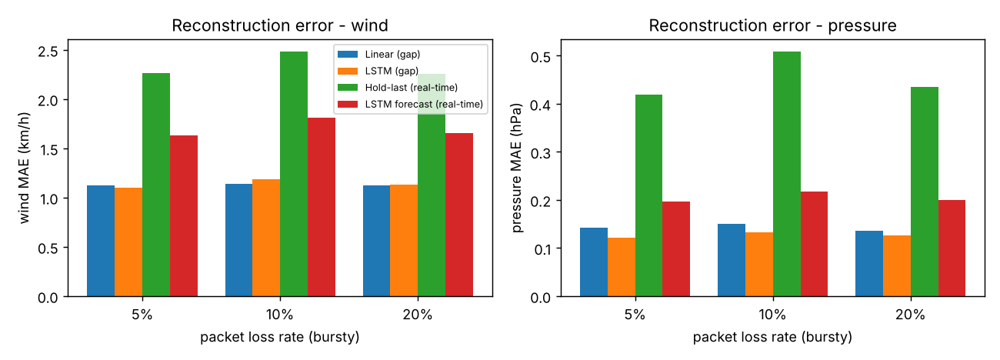
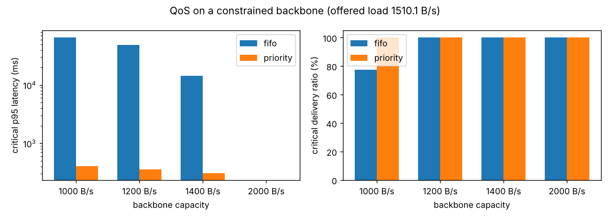

# Evaluation report

Generated by `python evaluate.py` on held-out simulated scenarios (ocean_model.py). These numbers measure the *mechanisms* on synthetic data; repeat with real buoy data before claiming field performance.

## 1. Packet-loss recovery (MAE, lower is better)

Gilbert-Elliott bursty loss (burstiness 0.6). Reconstruction model: **lstm**.

| Loss | Gaps (mean length) | Variable | Linear (gap repair) | LSTM (gap repair) | Hold-last (real-time) | LSTM forecast (real-time) |
|---|---|---|---|---|---|---|
| 5% | 423 (1.44) | wind | 1.124 | 1.098 | 2.267 | 1.634 |
| 5% | 423 (1.44) | temp | 0.049 | 0.046 | 0.067 | 0.051 |
| 5% | 423 (1.44) | pressure | 0.143 | 0.121 | 0.419 | 0.197 |
| 10% | 781 (1.5) | wind | 1.141 | 1.184 | 2.481 | 1.811 |
| 10% | 781 (1.5) | temp | 0.05 | 0.046 | 0.07 | 0.051 |
| 10% | 781 (1.5) | pressure | 0.15 | 0.133 | 0.508 | 0.218 |
| 20% | 1469 (1.58) | wind | 1.121 | 1.131 | 2.255 | 1.656 |
| 20% | 1469 (1.58) | temp | 0.05 | 0.047 | 0.069 | 0.051 |
| 20% | 1469 (1.58) | pressure | 0.136 | 0.127 | 0.434 | 0.2 |

Gap repair uses the readings on both sides of the gap; real-time concealment only has the past (the next packet has not arrived yet), so linear interpolation is impossible there.

Gap repair MAE by gap length (20% loss run):

| Gap length | Lost readings | Wind linear | Wind LSTM | Pressure linear | Pressure LSTM |
|---|---|---|---|---|---|
| 1 | 959 | 1.019 | 1.039 | 0.115 | 0.105 |
| 2-3 | 996 | 1.127 | 1.13 | 0.135 | 0.126 |
| 4+ | 372 | 1.368 | 1.368 | 0.192 | 0.186 |

## 2. QoS on a constrained backbone

4 buoys + satellite station + housekeeping, offered load **1510.1 B/s**. Same `QoSScheduler` code as the live gateway, simulated clock.

| Backbone | Scheduler | Critical delivered | Critical avg / p95 ms | Normal delivered | Normal p95 ms | Non-essential delivered |
|---|---|---|---|---|---|---|
| 1000 B/s | fifo | 77.3% | 58583.6 / 65803.0 | 82.4% | 67023.0 | 52.5% |
| 1000 B/s | priority | 100.0% | 89.5 / 407.0 | 82.1% | 120750.5 | 51.7% |
| 1200 B/s | fifo | 100.0% | 36642.0 / 49026.7 | 92.7% | 53063.4 | 80.0% |
| 1200 B/s | priority | 100.0% | 80.4 / 356.3 | 100.0% | 61416.3 | 51.7% |
| 1400 B/s | fifo | 100.0% | 10210.4 / 14346.1 | 100.0% | 21191.1 | 100.0% |
| 1400 B/s | priority | 100.0% | 78.7 / 305.0 | 100.0% | 1614.7 | 51.7% |
| 2000 B/s | fifo | 100.0% | 0.0 / 0.0 | 100.0% | 0.0 | 100.0% |
| 2000 B/s | priority | 100.0% | 0.0 / 0.0 | 100.0% | 0.0 | 100.0% |

## 3. QoS classifier

Label: thresholds breached now or within the next 10 readings.

| Policy | Precision | Recall | F1 | Mean warning lead (readings before first breach) | Calm traces with a false alarm (of 9) |
|---|---|---|---|---|---|
| rule | 1.0 | 0.695 | 0.82 | 0.0 | 0 |
| ml | 0.724 | 0.988 | 0.835 | 16.45 | 3 |
| hybrid | 0.724 | 0.99 | 0.837 | 16.45 | 3 |

## 4. Edge AI bandwidth (satellite frames, 4 bands, 16-bit)

| Frame | Storm intensity | Raw | zlib | Sent (features) | Saved vs raw | Saved vs zlib | Edge risk | Inference ms |
|---|---|---|---|---|---|---|---|---|
| 256x256 | 0.0 | 0.52 MB | 0.41 MB | 1027 B | 99.804% | 99.752% | 0.0 | 0.6 |
| 256x256 | 0.5 | 0.52 MB | 0.42 MB | 1041 B | 99.801% | 99.754% | 6.4 | 3.6 |
| 256x256 | 1.0 | 0.52 MB | 0.44 MB | 1039 B | 99.802% | 99.763% | 91.6 | 4.2 |
| 512x512 | 0.0 | 2.10 MB | 1.63 MB | 1028 B | 99.951% | 99.937% | 0.0 | 1.3 |
| 512x512 | 0.5 | 2.10 MB | 1.68 MB | 1040 B | 99.95% | 99.938% | 6.6 | 12.2 |
| 512x512 | 1.0 | 2.10 MB | 1.75 MB | 1040 B | 99.95% | 99.94% | 91.9 | 12.5 |
| 1024x1024 | 0.0 | 8.39 MB | 6.56 MB | 1028 B | 99.988% | 99.984% | 0.0 | 5.1 |
| 1024x1024 | 0.5 | 8.39 MB | 6.73 MB | 1041 B | 99.988% | 99.985% | 6.6 | 56.9 |
| 1024x1024 | 1.0 | 8.39 MB | 6.98 MB | 1039 B | 99.988% | 99.985% | 91.6 | 56.9 |

## Plots

